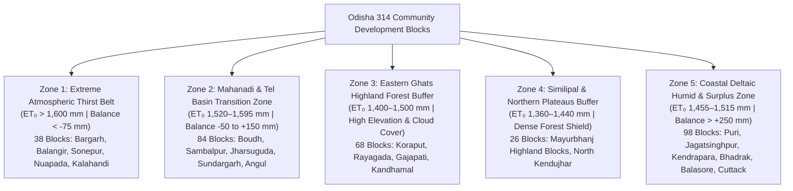

# Decadal (2016–2026) Evapotranspiration & Micro-Level Hydrological Analysis of Odisha
## A Decision-Support & Policy Action Framework for 314 Community Development Blocks

**Created & Analyzed by:** Gourab Kumar Swain (Lead Hydrological GIS Analyst)

**Prepared for:** 
* Department of Water Resources (DoWR), Government of Odisha
* Department of Agriculture & Farmers' Empowerment (DAFE) & Odisha Millet Mission (OMM)
* Odisha State Disaster Management Authority (OSDMA)
* Central Ground Water Board (CGWB) & Ground Water Survey Directorate, Odisha

**Dataset Sources:** High-resolution ECMWF ERA5-Land Reanalysis (FAO-56 Penman-Monteith potential evapotranspiration, 0.1° grid, 3,926 daily timesteps across 2016–2026), validated against IMD AWS observations and ISRO Bhuvan land-use baselines, mapped across all 30 Districts and **314 Community Development Blocks (Panchayat Samitis)**.

---

## 1. Executive Summary: The Evaporation Imperative

Evapotranspiration ($ET_0$) represents the atmospheric evaporative demand—the "atmospheric thirst"—driven by solar net radiation, ambient vapor pressure deficit, temperature, and aerodynamic wind speed. In tropical sub-humid states like Odisha, agricultural water planning has historically suffered from a single-dimensional bias: **measuring rainfall volume while ignoring evaporative loss**.

Across the 10-year decadal baseline (2016–2026):
* **Statewide Mean $ET_0$:** **1,509.1 mm/year** (ranging from **1,363.1 mm** in Samakhunta block, Mayurbhanj to **1,636.3 mm** in Sohela block, Bargarh).
* **Pre-Monsoon Summer Deficit (March–May):** Accounts for **33.8% to 37.2%** of annual evaporative loss (470 to 585 mm in just 92 days), with daily evaporative rates exceeding **7.8 to 8.8 mm/day** in Western Odisha.
* **Intra-District Micro-Divergence:** Intra-district variation reaches **126.8 mm in Mayurbhanj** and **92.9 mm in Kandhamal**. Macro district-level planning hides severe local water stress.
* **Decadal Climate Acceleration:** In heatwave years (2022, 2023), statewide evaporative demand surged by **+4.2% to +4.5%**, converting nominally normal monsoon seasons into mid-season agricultural moisture deficits.

---

## 2. Micro-Level Agro-Hydrological Zonation (314 Blocks)

Based on clustering of Annual $ET_0$, Pre-monsoon Summer $ET_0$, Net Water Balance ($P - ET_0$), and Aridity Index ($P / ET_0$), Odisha's 314 blocks divide into five distinct Agro-Hydrological Action Zones:

### Zone-by-Zone Characteristics & Micro-Statistics

| Zone | Primary Districts | Block Count | Annual $ET_0$ Range (mm) | Summer $ET_0$ (mm) | Mean Water Balance ($P - ET_0$) | Dominant Hydrological Risk |
| :--- | :--- | :---: | :---: | :---: | :---: | :--- |
| **Zone 1: Extreme Thirst Belt** | Bargarh, Balangir, Sonepur, Nuapada, Kalahandi | 38 | 1,600 – 1,636 | 570 – 585 | **-150 to -30 mm (Severe Deficit)** | High open-water evaporation, severe summer aquifer depletion, soil moisture desiccation |
| **Zone 2: Basin Transition Zone** | Sambalpur, Jharsuguda, Sundargarh, Boudh, Angul | 84 | 1,520 – 1,595 | 530 – 568 | -25 to +180 mm (Marginal/Moderate) | Erratic monsoon dry spells, canal tail-end water failure |
| **Zone 3: Eastern Ghats Highlands** | Koraput, Rayagada, Gajapati, Kandhamal | 68 | 1,400 – 1,500 | 465 – 515 | -80 to +120 mm (Variable) | Rapid slope runoff, low subsurface storage, micro-valley moisture contrast |
| **Zone 4: Similipal Forest Buffer** | Central/Northern Mayurbhanj, North Kendujhar | 26 | 1,360 – 1,440 | 480 – 505 | **+350 to +505 mm (High Surplus)** | Ecological vulnerability to canopy thinning, localized flash runoff |
| **Zone 5: Coastal Deltaic Surplus** | Jagatsinghpur, Kendrapara, Puri, Bhadrak, Balasore, Cuttack | 98 | 1,455 – 1,515 | 490 – 525 | **+250 to +485 mm (Surplus)** | Waterlogging, drainage congestion, cyclonic flooding, estuarine salinity ingress |

---

## 3. Departmental Policy Decisions & Implementation Matrix

### 3.1. Department of Water Resources (DoWR)

#### A. Canal Scheduling & Sluice Gate Calibration in Hirakud & Upper Indravati Commands
* **The Tail-End Paradox:** In Bargarh canal divisions (Attabira, Bargarh Sadar, Barpali, Sohela), water releases calibrated strictly to theoretical crop water requirements consistently fail at tail-end blocks. This is because **canal transmission losses to evaporation during March–May reach 18% to 24% of canal discharge** due to unlined conveyance and ambient temperatures exceeding 42°C.
* **Action Mandate:**
  1. Calibrate seasonal canal discharge using real-time $ET_0$ multipliers: increase tail-end releases by **+20% during March–May** or mandate lined conduits/piped irrigation networks (PIN).
  2. Implement rotational irrigation (*Warabandi*) with nocturnal water releases between 19:00 and 06:00 in Zone 1 blocks to slash daytime convective evaporative losses by up to 35%.

#### B. Farm Pond ("Mo Pokhari") Engineering Standard Revision
* **The Evaporation Sink Problem:** In Western Odisha, cumulative annual evaporation is ~1.62 meters. A farm pond designed with a standard depth of 2.0 meters loses **over 80% of its stored volume directly to the atmosphere** before Rabi crops can utilize it!
* **Action Mandate:**
  1. Revise MGNREGS and State Agriculture Policy farm pond design specifications for Western Odisha (Districts: Nuapada, Balangir, Bargarh, Sonepur, Kalahandi): **mandate minimum excavation depth of 3.5 to 4.0 meters** with reduced surface-area-to-volume ratio ($SA:V < 0.35$).
  2. Mandate agro-forestry vegetative shelterbelts (Bamboo, Neem, Subabul) along the Southern and Western peripheries of farm ponds to reduce prevailing dry wind velocity across the water surface, suppressing convective evaporation by 20–28%.
  3. Pilot modular shade balls or floating solar PV systems on community irrigation tanks in Komna, Sohela, and Bhawanipatna blocks.

---

### 3.2. Department of Agriculture & Farmers' Empowerment (DAFE) & Odisha Millet Mission (OMM)

#### A. Micro-Level Crop Substitution & Boro Paddy Phase-Out
Summer (Boro) Paddy has a crop coefficient ($K_c$) of 1.20 during mid-season. In Zone 1 blocks where Summer $ET_0$ is 580 mm, summer paddy demands **over 6,960 m³ of water per hectare (6.96 million liters/ha)**. This exceeds renewable aquifer recharge and drains reservoirs prematurely.

#### Crop Water Demand & Savings Matrix (per Hectare)

| Crop | Growing Season | Crop Factor ($K_c$) | Crop Water Demand ($ET_c$, mm) | Total Water Needed ($m^3/ha$) | Water Saved vs Boro Paddy ($m^3/ha$) | Policy Action |
| :--- | :--- | :---: | :---: | :---: | :---: | :--- |
| **Summer Boro Paddy** | Feb–May | 1.20 | 696 mm | **6,960 $m^3$** | Baseline (0) | **Mandatory Phase-Out in Zone 1** |
| **Mandia (Ragi / Finger Millet)** | Feb–May | 0.70 | 406 mm | **4,060 $m^3$** | **+2,900 $m^3$ (41.7% Saved)** | **100% Incentive under OMM** |
| **Greengram / Moong (Pulse)** | Feb–Apr | 0.65 | 345 mm | **3,450 $m^3$** | **+3,510 $m^3$ (50.4% Saved)** | Seed kits + NFSM bonus subsidy |
| **Sesamum (Til / Oilseed)** | Feb–May | 0.70 | 390 mm | **3,900 $m^3$** | **+3,060 $m^3$ (44.0% Saved)** | High-value oilseed cluster promotion |
| **Maize (Rabi/Summer)** | Jan–Apr | 0.85 | 490 mm | **4,900 $m^3$** | **+2,060 $m^3$ (29.6% Saved)** | Permitted only under drip fertigation |

* **Block-Specific Target Allocation:**
  * **Top 10 High-Deficit Blocks:** `Komna`, `Boden`, `Khariar` (Nuapada); `Bhawanipatna`, `Junagarh` (Kalahandi); `Sohela`, `Bijepur` (Bargarh); `Turekela`, `Patnagarh` (Balangir); `Boudh` (Boudh).
  * **Target:** Enforce a 60% transition of summer cropped area from paddy to Millets (Mandia, Suan) and Pulses (Moong, Biri) within 2 agricultural cycles, saving an estimated **420 million cubic meters of water annually** across these 10 blocks alone.

---

### 3.3. Central Ground Water Board (CGWB) & Odisha Ground Water Survey

#### Micro-Level Groundwater Vulnerability Index (GVI)
We compute the GVI for each block as:
$$GVI = \frac{ET_0 - P_{effective}}{R_{recharge}}$$

* **Critical Vulnerability Tier (GVI > 1.25):** 
  * Blocks: `Komna`, `Boden`, `Bhawanipatna`, `Turekela`, `Patnagarh`, `Khariar`, `Saintala`.
  * **Mandate:** Freeze all new commercial energization permits for deep tube wells; make micro-irrigation (drip/sprinkler) mandatory for obtaining agricultural power subsidies.
* **Safe Recharge Tier (GVI < 0.65):**
  * Coastal delta blocks (`Tirtol`, `Garadapur`, `Erasama`, `Aali`, `Kakatpur`) and northern buffers (`Samakhunta`, `Bangriposi`).
  * **Mandate:** Promote shallow filter points to harvest shallow post-monsoon aquifers without risking deep bedrock salinization.

---

### 3.4. Odisha State Disaster Management Authority (OSDMA)

#### Atmospheric Thirst Early Warning & Heatwave Action Plans
Drought assessment based exclusively on the Standardized Precipitation Index (SPI) fails to detect **"Flash Droughts"**—where sudden surges in temperature, radiation, and vapor pressure deficit rapidly desiccate root-zone soil moisture even when rainfall was normal 3 weeks prior.

* **Action Protocol:**
  1. Integrate the **Standardized Precipitation Evapotranspiration Index (SPEI)** into the OSDMA Disaster Risk Portal.
  2. When 7-day rolling $ET_0$ in any block exceeds **8.2 mm/day** accompanied by soil moisture anomalies below 20th percentile, trigger a **Level-2 Agricultural Drought Alert**.
  3. Pre-position emergency diesel pump subsidies and mandate life-saving supplemental irrigation from local harvesting structures.

---

## 4. Top 20 High-Priority Administrative Blocks Decision Summary

| Rank | Block Name | District | Annual $ET_0$ (mm) | Summer $ET_0$ (mm) | Annual Rain (mm) | Net Water Balance (mm) | Recommended Policy Intervention |
| :---: | :--- | :--- | :---: | :---: | :---: | :---: | :--- |
| **1** | **Sohela** | Bargarh | 1,636.3 | 584.2 | 1,588.6 | -47.7 | Boro paddy ban; Warabandi night canal releases; drip fertigation |
| **2** | **Bijepur** | Bargarh | 1,630.9 | 582.1 | 1,595.0 | -35.9 | Micro-irrigation cluster subsidy; farm pond deepening (>3.5m) |
| **3** | **Sonepur** | Sonepur | 1,626.1 | 581.0 | 1,625.3 | -0.8 | Canal tail-end discharge guarantee; millet mission promotion |
| **4** | **Binika** | Sonepur | 1,624.9 | 580.4 | 1,622.7 | -2.2 | Pulses intercropping; community pond shade buffers |
| **5** | **Birmaharajpur** | Sonepur | 1,623.5 | 580.0 | 1,620.1 | -3.4 | Tank silt removal; agro-forestry windbreaks on canal banks |
| **6** | **Patnagarh** | Balangir | 1,618.7 | 581.7 | 1,547.4 | -71.3 | Millets replacement (Mandia); deep tube-well moratorium |
| **7** | **Bhawanipatna** | Kalahandi | 1,618.4 | 570.7 | 1,489.3 | **-129.1** | Extreme Deficit Tier: 100% micro-irrigation; recharge shafts |
| **8** | **Komna** | Nuapada | 1,616.4 | 575.3 | 1,466.3 | **-150.0** | **State's #1 Deficit Block**: emergency drought fund; pulse clusters |
| **9** | **Saintala** | Balangir | 1,612.8 | 578.1 | 1,541.7 | -71.1 | Summer crop rationing; rainwater harvesting recharge trenches |
| **10** | **Belpara** | Balangir | 1,611.7 | 577.0 | 1,535.4 | -76.3 | Boro paddy phase-out; oilseed cluster incentive (Til/Mustard) |
| **11** | **Boden** | Nuapada | 1,606.9 | 572.0 | 1,481.4 | **-125.5** | High Deficit Tier: check-dam cascade; agro-silviculture |
| **12** | **Turekela** | Balangir | 1,605.7 | 576.2 | 1,504.4 | **-101.3** | Ground water extraction freeze; millet processing unit setup |
| **13** | **Boudh** | Boudh | 1,601.4 | 568.4 | 1,507.7 | **-93.7** | River lift irrigation efficiency tuning; mulching mandate |
| **14** | **Khariar** | Nuapada | 1,598.6 | 570.8 | 1,501.8 | **-96.8** | Critical Drought Vulnerability: drought-hardy pulses cluster |
| **15** | **Junagarh** | Kalahandi | 1,597.6 | 565.4 | 1,499.5 | **-98.1** | Upper Indravati canal scheduling overhaul; piped irrigation |
| **16** | **Gudvella** | Balangir | 1,597.1 | 573.0 | 1,545.2 | -51.9 | Drip irrigation subsidy for cotton & pulses |
| **17** | **Muribahal** | Balangir | 1,596.8 | 572.8 | 1,536.1 | -60.7 | Farm pond shelterbelt enforcement; soil moisture probes |
| **18** | **Dharamgarh** | Kalahandi | 1,595.4 | 564.2 | 1,515.6 | -79.8 | Piped irrigation conversion; soil carbon enrichment incentives |
| **19** | **Loisingha** | Balangir | 1,594.3 | 571.9 | 1,548.9 | -45.4 | Rotational canal turns; solar pump drip integration |
| **20** | **Attabira** | Bargarh | 1,592.5 | 574.1 | 1,612.4 | +19.9 | Canal evaporation minimization; tail-end volumetric pricing |

---

## 5. Conclusion & Action Roadmap

The empirical analysis of Odisha's decadal evapotranspiration datasets across all 314 blocks demonstrates that **water scarcity in Odisha is predominantly driven by evaporative demand rather than gross rainfall failure**. 

By shifting from generic district-level allocations to micro-level block zoning:
1. **The Department of Water Resources** can protect tail-end farmers in Western Odisha by adjusting seasonal releases for 20%+ evaporative loss.
2. **The Agriculture Department & Millet Mission** can target exact blocks where substituting 1 hectare of summer paddy with Mandia (Finger Millet) returns **2,900 cubic meters of freshwater** to depleted community reserves.
3. **Engineering agencies** can immediately stop building shallow evaporation traps masquerading as farm ponds and design climatically resilient 3.5m+ shaded water banks.
